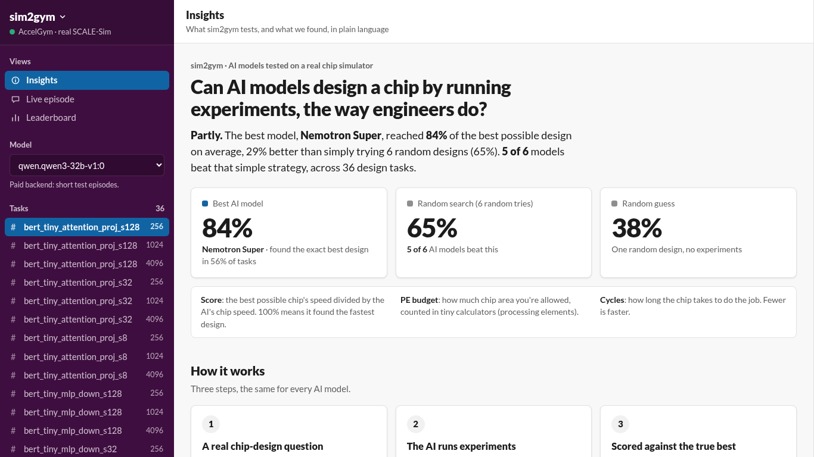
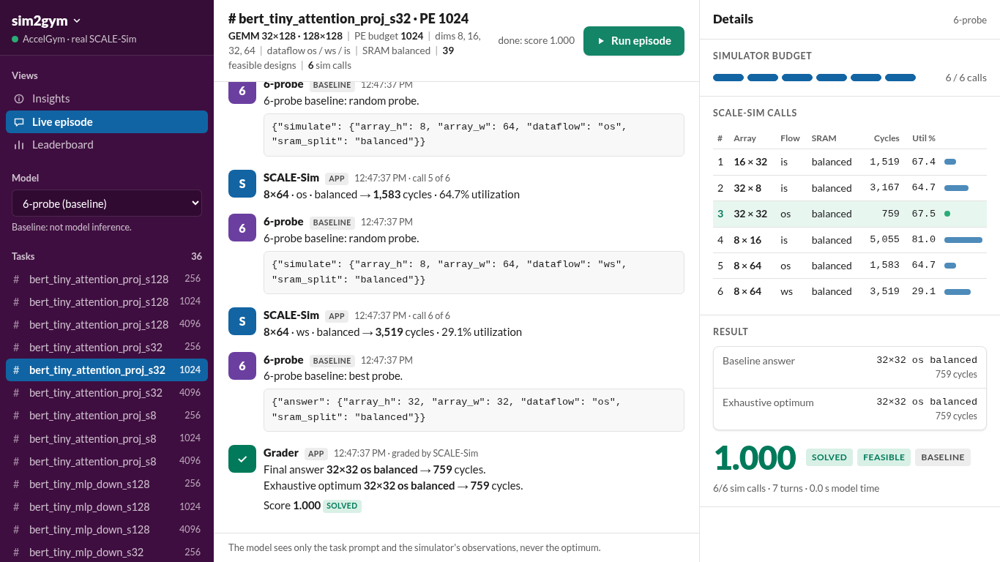
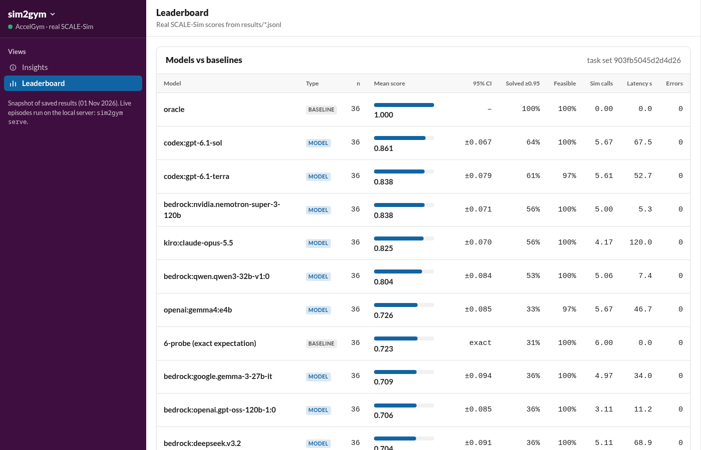

# sim2gym: real simulators → black-box RL environments for open models

> Chip companies make accelerator trade-offs every day. **sim2gym wraps a real open-source accelerator
> simulator as an RL environment.** The model has to *experiment* rather than recall a formula. This repo shows how
> open models do, and where they fail.

**AccelGym** is the first environment. The model designs a systolic-array AI accelerator for a real neural-network
layer:

- **Choices:** array height × width and dataflow (`os` / `ws` / `is`)
- **Constraint:** a processing-element (PE) budget
- **Goal:** minimise cycles

The model never sees a formula. It may call the **real SCALE-Sim simulator** up to 6 times. Its final answer is
then graded by SCALE-Sim against an **exact optimum** found by exhaustive search.

Built on open source:

| Project | Role |
|---|---|
| [SCALE-Sim](https://github.com/scalesim-project/scale-sim-v2) (`scalesim` 3.0.0, Georgia Tech) | Real cycle-level systolic-array simulator; grades every answer |
| Amazon Bedrock open-weight models (Nemotron, Qwen3, gpt-oss, Mistral, DeepSeek, Gemma 3) | Models evaluated on the leaderboard |
| [OpenRouter](https://openrouter.ai) free open-weight models (Nemotron, Gemma 4, …) | Free backend (rate-limited free tier) |
| Ollama / any OpenAI-compatible server | Optional local backend |
| Python, NumPy, FastAPI | Core, API and live demo |

## Quickstart

```bash
uv venv -p python3.12 .venv          # SCALE-Sim 3.0.0 works on 3.12
uv pip install -p .venv/bin/python -e '.[dev]'
cp .env.example .env                 # put OPENROUTER_API_KEY=... in .env (gitignored)

.venv/bin/sim2gym list                               # simulator, workloads, design space
.venv/bin/sim2gym build --seed 0 -o tasks.jsonl      # 36 design tasks with exact optima (fills cache/)
.venv/bin/sim2gym generate --seed 1 --n 12 -o tasks_gen_s1.jsonl  # 12 NEW sampled layers -> 36 more tasks
.venv/bin/sim2gym run tasks.jsonl --model oracle     # sanity check: must score 1.000
.venv/bin/sim2gym run tasks.jsonl --model 6-probe    # the baseline a model must beat
.venv/bin/sim2gym models --free                      # live list of free OpenRouter models
.venv/bin/sim2gym run tasks_eval.jsonl --model openrouter:nvidia/nemotron-3.5-super-vl:free --results results_eval
.venv/bin/sim2gym report results_eval --tasks tasks_eval.jsonl -o leaderboard_eval.md
.venv/bin/sim2gym serve                              # live demo at http://127.0.0.1:8765/  (API docs: /docs)
.venv/bin/python -m pytest -q                        # 147 tests (140 + 7 verifiers tests on Linux/macOS)
```

The first `build` runs SCALE-Sim over the whole grid: 576 simulations, about 3.5 minutes with 6 workers. After that
every simulate call is a cache hit, keyed by the input hash plus the SCALE-Sim version.

## Live demo

`sim2gym serve`, then open http://127.0.0.1:8765/. Pick a task (layer × PE budget) and a model, then press **Run**.
The page streams the episode over Server-Sent Events:

- every model message
- every SCALE-Sim call (array, dataflow, cycles, utilisation) against the budget meter
- the final design next to the exhaustive optimum, with its score

The **Leaderboard** tab reads `results/`. The **Insights** view (the landing page) explains the project and the
findings in plain language for non-engineers. Its numbers are computed live from `results/` by `GET /insights`.





## The environment

| | |
|---|---|
| Workloads | 12 real layers: 9 BERT-tiny GEMMs (attention projection, MLP up and MLP down at sequence lengths 8/32/128) and 3 ResNet-18 / MobileNetV2 1×1 convolutions. Tall-skinny and wide shapes are included on purpose. |
| Design space | `array_h`, `array_w` ∈ {8, 16, 32, 64}; `dataflow` ∈ {os, ws, is}; SRAM fixed at 3 × 64 kB; bandwidth fixed |
| PE budgets | 256 / 1024 / 4096, giving 18 / 39 / 48 feasible designs |
| Tasks | 36 (12 layers × 3 budgets). In 24 of them the optimal array is **non-square**. |
| Protocol | The model ends every reply with one JSON object: `{"simulate": {...}}` costs 1 of 6 calls and returns cycles, utilisation and stalls; `{"answer": {...}}` ends the episode. One malformed-reply retry; max turns = budget + 2. |
| Grading | Infeasible, invalid or over the PE budget → 0. Otherwise `score = optimum_cycles / answer_cycles`, which is in [0, 1]. Solved = score ≥ 0.95. |

The optimum comes from an exhaustive search over a discrete space, so it is exact, not a heuristic.

### RL / programmatic use

```python
from sim2gym.tasks import load_tasks
from sim2gym.env import Sim2GymEnv

env = Sim2GymEnv(load_tasks("tasks.jsonl"))
obs = env.reset(0)                                   # task prompt
obs, reward, done, info = env.step('{"simulate": {"array_h": 16, "array_w": 64, "dataflow": "os", "sram_split": "balanced"}}')
# reward stays 0 until the episode ends, then equals the task score in [0, 1]
```

The evaluation runner, the baselines, the live demo and the `verifiers` adapter all drive this same `Sim2GymEnv`,
so evaluation and RL share one scoring path.

### Unlimited tasks: the generator

The 12 fixed layers are a benchmark; a training gym needs fresh tasks that no model has seen. `sim2gym generate`
samples new layers from a seed and builds tasks with the same exhaustive SCALE-Sim optimum:

- **GEMMs** like transformer projections, from single-token decode to short prefill: M ∈ {1 … 256}, K and N ∈
  {64 … 768}, including non-powers of two (96, 192, 384, 768).
- **Convolutions** on 7/14/28-pixel inputs, 1×1 or 3×3 filters, stride 1 or 2, 16–512 channels.
- Capped at the size of the largest fixed layer (8M multiply-adds), so SCALE-Sim stays fast. Never repeats a fixed
  layer, and never repeats a shape within a set. The same seed always gives the same tasks.

`tasks_gen_s1.jsonl` (seed 1) is checked in with its SCALE-Sim cache: 12 new layers, 36 tasks, 576 simulations,
about 10 minutes with 4 workers on a laptop. In 23 of its 36 tasks the best array is non-square. Random search with
6 probes scores 0.789 on it (exact expectation), against 0.723 on the fixed set, so this seed is slightly easier.

### `verifiers` (Prime Intellect) environment

`src/sim2gym_vf` exposes AccelGym as a [verifiers](https://github.com/PrimeIntellect-ai/verifiers) v1 environment
(id `sim2gym-vf`), so existing open-source RL trainers and the Environments Hub can use it. The episode is the same
`Sim2GymEnv`: the task prompt opens the chat, each model reply is stepped through the env, the observation comes back
as the next user turn, and the final score is the reward (`sim2gym_score`, plus `solved`, `feasible` and
`sim_calls_used` metrics).

```bash
uv pip install -p .venv/bin/python -e '.[dev,vf]'    # verifiers v1 needs Linux or macOS (it imports fcntl)
.venv/bin/vf-eval sim2gym-vf -m <model> --client.base-url <openai-compatible-url> --client.api-key-var <ENV_VAR>     --env.taskset.path tasks.jsonl --env.player.runtime.type subprocess --no-push -n 36
.venv/bin/vf-eval sim2gym-vf ... --env.taskset.generate-seed 7 --env.taskset.generate-n 12   # fresh tasks
```

`--no-push` keeps results local (vf-eval uploads to Prime Intellect by default). `--env.player.runtime.type
subprocess` runs locally instead of in a Prime sandbox. Checked end to end on Linux (WSL Ubuntu 24.04, verifiers
0.4.0) with a scripted OpenAI-compatible server: the rewards vf-eval recorded equal `grade_design` exactly.

### Accuracy checks

- All 576 cached SCALE-Sim results for the fixed tasks were re-simulated from scratch: 0 differences.
- The stored optimum is the minimum over every feasible design for every task, fixed and generated.
- The oracle scores exactly 1.000 on all 36 tasks; no result anywhere scores above 1.0.
- Every leaderboard number was recomputed independently from `results/*.jsonl`.
- Random baselines are reported as exact expectations over every possible draw, not one seeded draw.

## Results

All 36 tasks (`tasks.jsonl`, task set `903fb5045d2d4d26`), on Amazon Bedrock open-weight models at temperature 0.
Every number below comes from `results/*.jsonl` (see [`leaderboard.md`](leaderboard.md)).

| Model | Type | n | Mean score | 95% CI | Solved (≥0.95) | Feasible | Mean sim calls | Mean latency (s) |
|---|---|---:|---:|---:|---:|---:|---:|---:|
| oracle (exhaustive optimum) | baseline | 36 | 1.000 | – | 100% | 100% | 0.00 | – |
| **Nemotron Super 3 120B** (`nvidia.nemotron-super-3-120b`) | model | 36 | **0.838** | ±0.071 | 56% | 100% | 5.00 | 5.3 |
| **Qwen3 32B** (`qwen.qwen3-32b-v1:0`) | model | 36 | **0.804** | ±0.084 | 53% | 100% | 5.06 | 7.4 |
| Gemma 3 27B (`google.gemma-3-27b-it`) | model | 36 | 0.709 | ±0.094 | 36% | 100% | 4.97 | 34.0 |
| gpt-oss 120B (`openai.gpt-oss-120b-1:0`) | model | 36 | 0.706 | ±0.085 | 36% | 100% | 3.11 | 11.2 |
| DeepSeek V3.2 (`deepseek.v3.2`) | model | 36 | 0.704 | ±0.091 | 36% | 100% | 5.11 | 68.9 |
| **6-probe, exact expectation** (6 random simulator calls, keep the best; mean over every possible draw) | baseline | 36 | **0.723** | exact | 31% | 100% | 6.00 | – |
| Mistral Large 3 675B (`mistral.mistral-large-3-675b-instruct`) | model | 36 | 0.590 | ±0.102 | 22% | 94% | 0.42 | 5.4 |
| max-square-ws (largest square array, ws dataflow) | baseline | 36 | 0.521 | ±0.086 | 8% | 100% | 0.00 | – |
| random feasible design, exact expectation | baseline | 36 | 0.399 | exact | 6% | 100% | 0.00 | – |

All six models ran on the same 36 tasks with the same settings. The 6-probe and random rows are exact expectations
over every possible random draw, computed from the cached SCALE-Sim grid. The single seeded draws in
`results/` scored 0.650 (6-probe) and 0.380 (random); one draw is luck, so we compare against the expectation.
95% CI is ±1.96 standard errors over the 36 tasks (one run per task): models closer than about 0.1 are not
reliably ranked.

### What the results show

- **Only 2 of 6 models beat blind random search.** With the same 6 simulator calls, random search scores 0.723 on
  average. Per task (paired, 95% CI), **Nemotron Super 3** is +0.115 above it [+0.040, +0.190] and **Qwen3 32B** is
  +0.080 [+0.003, +0.158], only just clear. Gemma 3, gpt-oss and DeepSeek are within ±0.02 of it: no
  measurable difference.
- **Skipping experiments costs the most.** Mistral Large 3 answered **33 of 36 tasks without a single simulator
  call** and scored 0.133 below random search [−0.233, −0.033]. 2 of its answers used array sizes that are not
  allowed, so they score 0. gpt-oss 120B used about 3 calls.
- **A "bigger array is better" bias.** In 10–17 of the 36 tasks, each model's final array was larger than the
  optimal one.

### A real failure (from `results/bedrock_qwen.qwen3-32b-v1_0.jsonl`)

**Task:** `bert_tiny_mlp_down_s8`, a GEMM (8×512)·(512×128) with a 4096-PE budget. The exhaustive optimum is
**8×8, os: 8,415 cycles at 97% utilisation**.

| Qwen3 32B call | Design | SCALE-Sim cycles | Utilisation |
|---|---|---:|---:|
| 1 | 64×64 os | 13,231 | 1.0% |
| 2 | 32×64 os | 13,167 | 1.9% |
| 3 | 16×64 os | 13,135 | 3.9% |
| 4 | 8×64 os | 13,119 | 7.8% |
| 5 | 64×64 ws | 13,107 | 1.0% |
| **answer** | **64×64 ws** | **13,107** | score **0.64** |

The model shrank only the height and never tried a narrow array, although utilisation was about 1%. Mistral Large 3
answered 32×64 ws on this task without simulating. On ResNet-18's `layer4` downsample, Qwen3 found the tall-skinny
optimum **64×8** by experiment (score 1.0). Mistral guessed 64×32 without simulating and scored 0.40.

### Free models (OpenRouter)

The OpenRouter backend works and was tested live, but free-tier keys are capped at 50 free-model requests per day.
Our 12-task run of Nemotron 3.5 Super, Nemotron 3 Ultra, dots-3-note and Gemma 4 hit that cap after 1–3 tasks per
model. Those partial results are in `results_eval/` and are not ranked.

## Wrap your own simulator

The environment only needs a plain function. `src/sim2gym/packs/accel.py` is the whole SCALE-Sim integration:

- write a config and a topology file
- run `scalesim`
- parse `COMPUTE_REPORT.csv`
- cache the result

```python
def simulate(layer: dict, array_h: int, array_w: int, dataflow: str, sram_split: str) -> dict:
    ...  # run the real tool
    return {"cycles": ..., "stall_cycles": ..., "utilization_pct": ...}
```

To add another tool, write the same function plus `feasible_designs()` and `validate_design()`. Tasks, exact
optima, grading, the environment, the runner, the API and the live page all reuse them.

## HTTP API

`sim2gym serve` binds to 127.0.0.1:8765. The schemas are documented at `/docs`.

| Route | Purpose |
|---|---|
| `GET /health` | Service status (does not claim the model endpoints are reachable) |
| `GET /simulators`, `POST /simulators/accel/simulate` | Design space metadata; real SCALE-Sim run |
| `GET /models` | Free OpenRouter models, baselines and Bedrock models (allowlisted server-side) |
| `POST /tasks`, `GET /tasks/{id}` | Seeded task sets; the public view never includes the optimum |
| `POST /sessions`, `POST /sessions/{id}/step` | Interactive episode using the JSON protocol |
| `POST /runs`, `GET /runs/{id}`, `GET /leaderboard` | Bounded synchronous runs; leaderboard from saved results |
| `GET /live?task_id=…&model=…` | Server-Sent Events stream of one episode (used by the demo page) |

Model keys and endpoints are server-side only: the key comes from `.env` or the environment and is never logged,
returned or saved. API clients cannot supply URLs, file paths or code. This is a **single-user local demo**: there
is no auth, sessions live in memory (lost on restart), and it needs a single worker.

## Model backends

| Prefix | Backend | Notes |
|---|---|---|
| `openrouter:<id>` | OpenRouter (main) | Free models (`:free`); temperature 0; max 12k tokens, because reasoning models think first; 429s back off and honour Retry-After |
| `bedrock:<modelId>` | Amazon Bedrock Converse (us-east-1, AWS CLI credentials) | **Paid:** by default capped at 2 tasks × 2 turns and written to `results/smoke/`; `--allow-paid` (CLI) or `SIM2GYM_ALLOW_PAID=1` (server) lifts the cap |
| `openai:<model>` | Any OpenAI-compatible server (e.g. Ollama) | Uses `SIM2GYM_BASE_URL` |
| `oracle`, `random`, `max-square-ws`, `6-probe` | Baselines, labelled as such | Not model inference |

## Honest limits

- v0.1, built in one day for Hacktoberfest Hack Day × AI for Vizag.
- One real simulator so far, with a small discrete design space (4 × 4 × 3, SRAM split fixed) and small layers so
  that simulation stays fast.
- SCALE-Sim models cycles, not area or power; the PE budget stands in for area. The reported cycles cover compute
  plus stalls, excluding the initial prefetch and the final DRAM drain.
- Evaluated on hosted open-weight models at temperature 0, one run each, 36 tasks. That is enough to see patterns,
  not to claim fine-grained rankings. No RL training run yet.
- Prior work: LUMINA (Mar 2026) and PerfReasoning (Sep 2026) already test LLMs on hardware trade-offs. sim2gym's
  contribution is a **generator of black-box, budgeted environments from real simulators**, not "the first
  chip-reasoning benchmark".
- Generated tasks are not yet evaluated on models; the leaderboard is the fixed 36-task set.
- Next steps: publish `sim2gym-vf` on the Environments Hub, ngspice + SKY130 inverter sizing, and RL training.

## License

MIT
